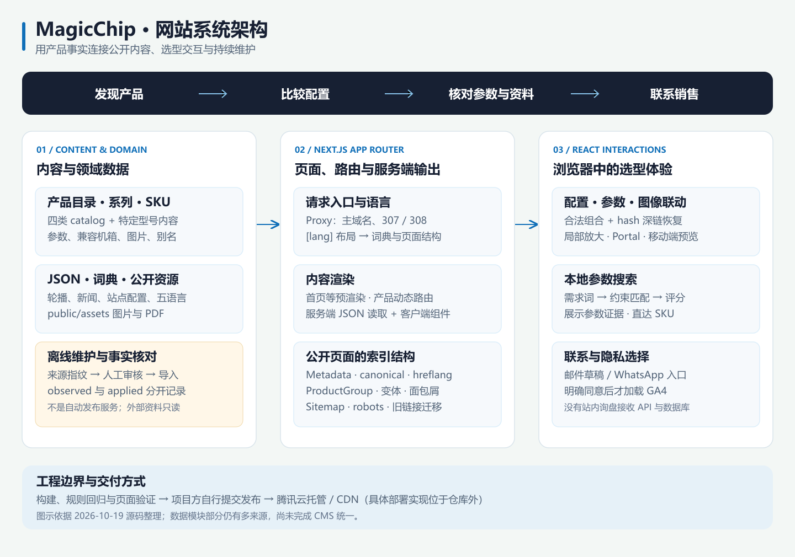
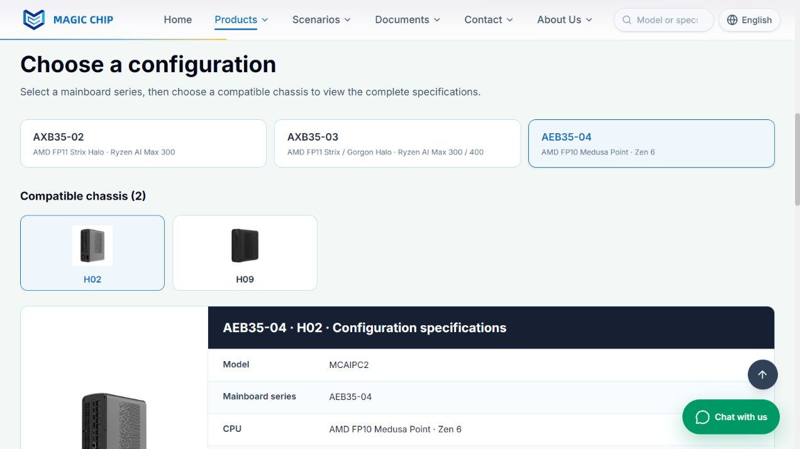
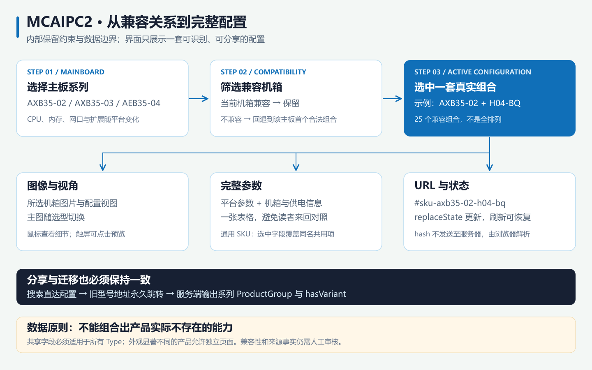
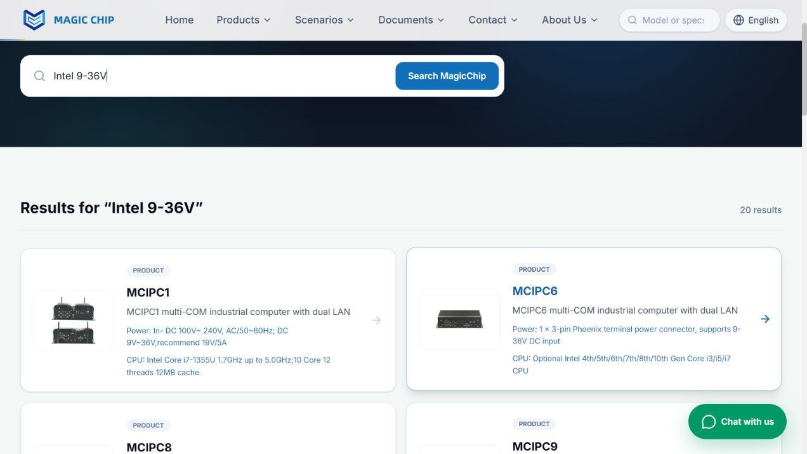
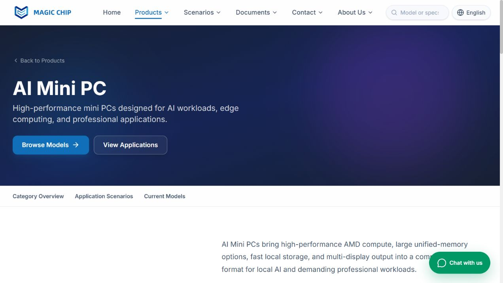
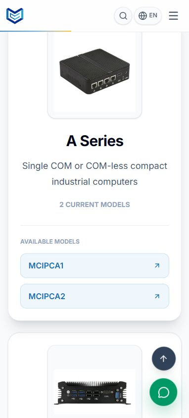

# MagicChip 企业硬件官网｜项目介绍与面试讲述稿

> 一套围绕「产品发现 → 参数选型 → 资料核对 → 联系销售」构建的多语言 B2B 官网。
>
> 核对日期：2026-10-19。本文依据当前仓库源码、实际安装依赖、本地生产构建和回归检查编写。截图来自本地网站；架构图为依据源码整理的示意图。

**阅读方式**：面试开场可直接使用第 1 节；深入交流时，重点展开第 6～9、12～13 节；技术追问参考第 18 节。第一人称用于示范讲述，个人职责、团队分工和投入时间请按本人实际经历表达。


## 目录

1. [两分钟项目介绍](#pitch)
2. [业务背景与项目目标](#background)
3. [网站范围与信息架构](#scope)
4. [技术栈与选型理由](#stack)
5. [整体架构与渲染方式](#architecture)
6. [核心设计：产品系列与 SKU 配置](#sku)
7. [核心设计：理解硬件参数的站内搜索](#search)
8. [核心设计：以 URL 为依据的多语言](#i18n)
9. [SEO 与旧链接迁移](#seo)
10. [视觉与交互设计思想](#design)
11. [图片与细节查看](#images)
12. [产品资料更新与可追溯性](#content)
13. [GA4、隐私选择与事件设计](#analytics)
14. [资料下载与询盘体验](#contact)
15. [工程组织与安全边界](#engineering)
16. [验证方法、运行和发布](#validation)
17. [当前取舍与后续演进](#roadmap)
18. [面试追问与回答示例](#questions)
19. [演示顺序与源码索引](#demo)

---

<a id="pitch"></a>
## 1. 两分钟项目介绍

我介绍的项目是 MagicChip 企业硬件官网，服务于工业电脑、AI Mini PC、商业电脑和网络设备的海外 B2B 客户。

它的核心问题是：产品数量多，型号关系复杂，同一系列内部还可能存在不同处理器、主板、内存、机箱和接口组合。用户既需要快速找到适合需求的产品，也需要确认自己看到的图片和参数属于同一套配置。如果只是不断增加独立详情页，导航、搜索和内容维护都会越来越难。

技术上，我采用 Next.js App Router、React、TypeScript 和 Tailwind CSS，使用 Framer Motion 处理页面动效，Lucide 提供 SVG 图标。首页和部分内容通过服务端读取 JSON；产品目录以 TypeScript 数据模块组织；交互组件负责配置切换、图片查看和搜索。

我重点处理了四件事。第一，建立系列页与 SKU 的对应关系，用一张完整参数表展示选中配置，同时保留必要的独立外观页面。第二，实现面向硬件需求的搜索，让「Intel 9-36V」这类查询能够判断参数适用范围，并展示匹配依据。第三，将五种语言放进独立 URL，统一首屏语言、内部链接和 SEO，同时处理旧地址跳转。第四，将 GA4 统计放在明确的用户选择之后，区分浏览、联系意图和真正的业务结果。

这个项目让我学到，企业官网的复杂度并不只在页面数量。更重要的是，让产品事实、交互状态、搜索结果和页面地址保持一致，并且在产品持续更新时仍然能够维护和验证。

<a id="background"></a>
## 2. 业务背景与项目目标

### 用户是谁

网站主要面向工程选型人员、系统集成商、采购和渠道客户。他们的关注点不同：工程人员需要确认 CPU、供电、网络和扩展接口；采购关心可选型号及资料；渠道客户需要了解产品范围、公司和生产能力。

因此，我把网站理解为**产品信息与选型入口**。页面需要支持用户做出下一步判断，而不是只展示一组漂亮的设备图片。

### 业务问题如何转化成技术任务

| 业务问题 | 我的处理方式 | 带来的直接变化 |
| --- | --- | --- |
| 型号越来越多，菜单难以浏览 | 分类 → 系列 → 具体页面或 SKU，型号自然排序 | 菜单保持可扫描，独立外观仍有自己的入口 |
| 同系列参数容易混用 | 配置数据与共用字段分开维护，展示时合并 | 用户只需阅读选中配置的一张完整参数表 |
| 用户先知道需求，不知道型号 | 参数搜索、多语言需求词、场景推荐 | 可以从电压、平台、接口或应用任务进入产品 |
| 切换语言后不清楚当前状态 | 五种语言使用独立路由 | URL 可识别、刷新可还原、链接可分享 |
| 产品更名或合并导致旧链接失效 | 永久跳转到系列页及对应 SKU 锚点 | 原有分享地址继续到达正确内容 |
| 参数更新来源分散 | 来源清单、内容指纹、逐项核对 | 能区分「发现变动」与「完成同步」 |
| 需要了解访问行为 | 同意控制下的 GA4 手动事件 | 观察产品关注和联系意图，避免把草稿当成有效询盘 |

### 可以作为个人职责展开的工作

根据实际参与范围，可以讲述需求梳理、信息架构、前端页面与组件、产品配置建模、路由及 SEO、搜索规则、资料整理和验证等工作。讲述时应选择自己能够解释代码与取舍的部分，不把协作成果或 AI 辅助生成的内容自动归为独立完成。

<a id="scope"></a>
## 3. 网站范围与信息架构

### 主要模块

| 模块 | 当前作用 |
| --- | --- |
| 首页 | 四张轮播、产品分类、重点产品、服务、客户展示和联系入口 |
| 产品总览与分类页 | 工业、AI、商业、防火墙/服务器四个入口；分类内按系列浏览 |
| 产品详情 | 型号介绍、配置选择、产品图片、完整参数和联系入口 |
| Scenarios | 工业自动化、本地 AI、网络安全、数字标牌、商务教育、IoT、面板 HMI、NAS 存储八类场景 |
| Documents / Downloads / Tech Docs | 资料导航、证书展示、原始证书及测试报告访问 |
| Company / Factory / About | 公司、生产能力、工厂图片和认证资料展示 |
| News | 多语言标题、摘要、分类与文章入口；正文仍保留模板占位内容 |
| Contact 与聊天组件 | 联系方式、WhatsApp、邮件草稿与复制回退 |
| 网站政策 | 隐私政策、Cookie 政策、网站条款和统计偏好设置 |

### 当前规模：注意统计口径

| 指标 | 核对结果 | 含义 |
| --- | --- | --- |
| 界面语言 | 5 种 | 英、德、法、意、西 |
| 顶层产品分类 | 4 类 | 不是旧 README 中历史分类 ID 的简单沿用 |
| 产品 SEO 入口 | 110 个 | `productSeo` 的规范产品/系列页面条目，不含每个 SKU 单独建页 |
| 产品/SKU 搜索条目 | 164 个 | 同时含系列入口与配置入口，不能写成 164 个独立产品详情页 |
| 场景 | 8 类 | 场景推荐引用当前目录和具体配置 |
| MCAIPC2 | 3 个主板系列、14 种机箱记录、25 个兼容组合 | 兼容关系不是全量笛卡尔积 |
| 证书 | 4 类、8 份 PDF | CE EMC、CE LVD、FCC SDoC、RoHS，各含证书与报告 |
| 最近本地生产构建 | 96 个预渲染路径 | 不包含全部按请求渲染的产品页面；这不是性能得分 |

上表是代码快照，不代表销量、访问量、转化率或当前库存。项目目前没有可据此证明的商业增长数据。

### 页面层级

```text
/{lang}
├── products
│   ├── industrial-mini-pc
│   ├── ai-mini-pc
│   ├── commercial-mini-pc
│   └── firewall-mini-pc
│       └── [id] → 必要时通过 #sku-… 选择具体配置
├── scenarios
├── documents / downloads / tech-docs
├── company / factory / about
├── news / [id]
├── contact
└── privacy-policy / cookie-policy / terms-of-use
```

NAS 主板属于商业产品分类下独立的 NAS-MB 分组。主板与 NAS 整机不共用机箱、适配器或外观参数。

<a id="stack"></a>
## 4. 技术栈与选型理由

以下版本以本地实际安装结果为准；`package.json` 中部分依赖使用范围声明，不能把范围写成精确版本。

| 技术 | 核对版本/配置 | 在项目中的职责 | 选择理由与限制 |
| --- | --- | --- | --- |
| Next.js | 16.1.6，App Router / Turbopack | 路由、布局、预渲染、服务端元数据、图片及字体能力 | 官网需要可索引页面与统一路由；仍需运行 Next 服务，当前没有配置纯静态导出 |
| React / React DOM | 18.3.1 | 页面组件、状态、Context、Portal | 用组件组织重复结构与交互，不引入额外全局状态库 |
| TypeScript | 实际 5.0.2；`strict: true` | 产品类型、配置结构、翻译结构与边界检查 | 降低多型号数据接错的风险；当前构建提示推荐至少 5.1，属于待升级项 |
| Tailwind CSS | 实际 4.3.3 | 布局、断点、主题色与交互状态 | 直接表达组件样式，通过主题变量避免颜色散落 |
| Framer Motion | 实际 12.42.2 | 首屏、轮播和滚动入场动效 | 将进入/退出状态放在组件中管理；需继续控制非必要动效与客户端体积 |
| Lucide React | 0.577.0 | 导航、箭头、搜索、联系等 SVG 图标 | 轮廓统一，避免移动系统将字符箭头当成 emoji |
| React Simple Maps | 3.0.0 | 首页全球客户地图 | 配合项目内 TopoJSON 显示地图；不是实时业务数据大屏 |
| Next Font / Next Image | 框架内置 | Inter 字体及部分图片加载 | 已有接入，但仍有原生 `img`，不能宣称全站图片已完成优化 |
| Node.js / npm | 本机 Node 24.13.0 | 开发、构建、脚本和测试 | Next 本地包声明 Node ≥20.9.0；线上运行环境仍须单独核实 |
| Python 工具链 | pypdf、PyMuPDF、pdfplumber、Pillow | PDF 读取、图像提取、缩略图和资料辅助导入 | 属于离线维护流程，网站运行不依赖本机册子目录 |
| GA4 | 手动接入 gtag | 在同意后统计公开页面和有限交互 | 不引入客户端表单内容或搜索词作为统计参数 |
| Git / 腾讯云 | 仓库版本管理；托管/CDN 由项目方确认 | 变更记录及上线交付 | 当前仓库未发现 `.github/workflows`，不把外部发布流程写成仓库已实现的自动流水线 |

项目没有引入数据库、ORM、Redis、独立搜索服务、管理后台或前端电商交易链路。这是当前产品范围和维护成本之间的取舍。

<a id="architecture"></a>
## 5. 整体架构与渲染方式



### 5.1 三层分工

我把实现理解为三层：

1. **内容与领域数据层**：产品目录、SKU、别名、场景、证书、翻译和 JSON 内容。
2. **页面与交互层**：服务端布局/元数据和 React 客户端组件，共同完成可阅读页面与交互。
3. **维护与验证层**：册子指纹、导入脚本、图像处理、规则测试、生产构建和人工页面检查。

这不是一个已经完成后端闭环的全栈业务平台。当前核心是公开内容展示、规则化选型和浏览器交互。

### 5.2 服务端与客户端各做什么

| 服务端/构建阶段 | 浏览器交互阶段 |
| --- | --- |
| `content-loader.ts` 从项目 `content/` 读取 JSON | SKU、主板、机箱选择 |
| `[lang]/layout.tsx` 确认语言并传入词典 | 语言切换触发路由导航 |
| 首页和新闻等路由生成页面 | 搜索建议、键盘选择、搜索弹层 |
| 产品 layout 生成 Metadata、JSON-LD，并处理别名跳转 | 图片预览、鼠标细节放大 |
| Sitemap、robots 和静态资源准备 | 邮件草稿、聊天入口、地图加载选择 |
| 部分页面预渲染，动态产品路由按请求处理 | GA4 同意状态与事件触发 |

首页是服务端页面组合客户端交互组件。分类、产品等页面目前仍存在较大的客户端组件。`use client` 表示客户端模块边界，不等于首次访问只有一张空白 HTML；Next 可以预渲染客户端组件的 HTML，再进行 hydration。这个机制不意味着项目已经把所有内容都做成静态页面。[Next 官方说明](https://nextjs.org/docs/app/getting-started/server-and-client-components)。

### 5.3 状态为什么没有全部放进全局 Store

我按状态的生命周期选择存放位置：

| 状态 | 存放位置 | 原因 |
| --- | --- | --- |
| 当前语言 | URL + 服务端传入的 Context | 刷新、分享和搜索引擎必须看到一致语言 |
| 默认访问的语言偏好 | Cookie，辅以 localStorage | 只辅助根路径分流，不能覆盖明确的语言网址 |
| 选中 SKU | 组件 state + hash | 交互即时，配置链接可分享 |
| 搜索词 | 输入状态；完整结果页使用 `?q=` | 查询可回看，不需要持久化整个搜索面板状态 |
| 图像视角、菜单、弹层 | 局部 state | 只影响当前组件 |
| 统计选择 | localStorage + 可订阅模块状态 | 需要跨组件、跨标签页同步，并处理过期 |

Context 用于语言；统计选择通过 `useSyncExternalStore` 订阅。项目当前没有 Redux、Zustand 或服务端查询缓存库。

<a id="sku"></a>
## 6. 核心设计：产品系列与 SKU 配置

### 6.1 最值得讲的业务建模问题

同系列设备可能共享部分描述，但 CPU、内存、网络接口、供电和机箱又存在差异。我没有简单把所有可选参数拼成一个“最高配”，因为那可能组合出一台实际不存在的机器。

例如 MCAIPC2 需要先选主板系列，再选择兼容机箱；MCAIPC3 的四种 Type 需要分别展示 AMD/Intel、板载内存/SO-DIMM、扩展接口和对应图片；MCIPCB2-J5005 因外观和接口布局不同，继续保留独立页面。



图中切换至 AEB35-04 后，只保留该平台的两个兼容机箱，参数表同步显示选中的 AEB35-04 + H02；默认配置与这一演示状态不同。

### 6.2 数据分层，阅读合并

内部保留共用字段和 SKU 字段，展示时合成一张完整参数表。这样既减少重复数据，也避免用户在两个区块之间来回查找。

```ts
type ProductSpecification = { label: string; value: string };

type ProductConfiguration = {
  key: string;
  label: string;
  legacyNames: string[];
  image: string;
  specs: ProductSpecification[];
  // 实际类型还包含本地化名称与图库。
};
```

`mergeSpecifications()` 使用大小写无关的字段名作为 Map key：先放共用字段，再放选中配置，后者覆盖同名字段，最后按 CPU、内存、显示、网络等顺序排序。

**关键前提**：只有确实对所有 SKU 成立的字段才能放进共用数据。覆盖算法本身不能识别录入人员把某一 Type 的专属参数误放进共用表的情况。

### 6.3 MCAIPC2：显式兼容关系



我为主板系列和机箱建立兼容关系，只生成真实存在的 25 个组合。切换主板时，如果当前机箱仍兼容，就保留机箱；否则回退到该主板的首个兼容组合。

默认配置是 AXB35-02 + H04-BQ。组合使用 `#sku-{主板}-{机箱}` 标识，例如：

```text
/en/products/ai-mini-pc/mcai2#sku-axb35-02-h04-bq
```

按钮切换更新 state，并使用 `history.replaceState` 更新 hash，减少连续选型产生的大量浏览器历史记录。首次打开链接或收到 `hashchange` 时，解析配置并滚动到配置区。

Hash 不会随 HTTP 请求送往服务器，因此具体配置由浏览器恢复。服务端输出系列级产品信息及所有变体的结构化数据；不能声称服务器直接读取 hash 生成选中 SKU。

### 6.4 复用组件与保留例外

| 组件/模块 | 职责 |
| --- | --- |
| `ProductConfigurationSelector` | 通用 Type/SKU 选择、hash 恢复、选中状态和配置回调 |
| `Mcaipc2Configurations` | 主板 → 兼容机箱的两步选择 |
| `ConfigurationSpecifications` | 当前视角、配置图片和完整参数组合 |
| `SpecificationTable` | 深色表头、浅色交替行、标签和值的统一阅读方式 |
| `product-navigation.ts` | 自然排序、同系列独立页面分组 |

复用的是交互和数据结构，不是强行统一所有产品事实。单型号页保留更舒展的参数表；多配置页使用紧凑布局。主图随配置切换，避免用户看到 A 型图片却在阅读 B 型接口。

源码：[参数类型与合并](../../lib/product-specifications.ts)、[通用选择器](../../components/ProductConfigurationSelector.tsx)、[MCAIPC2 选择器](../../components/Mcaipc2Configurations.tsx)、[AI 目录](../../lib/ai-catalog.ts)。

<a id="search"></a>
## 7. 核心设计：理解硬件参数的站内搜索

### 7.1 为什么不用简单的字符串包含

采购可能搜索型号，工程师更常输入“Intel 9-36V”“USB4”“DDR5”或“wide voltage”。如果只做全文包含，会把 Intel 网卡误当成 Intel CPU，或把供电 12V 的设备错误匹配到 9–36V 范围。

我采用**本地索引 + 规则匹配 + 参数证据**。目前没有向量数据库、外部搜索服务、运行时大模型或自然语言推理服务。



### 7.2 搜索处理流程

```text
用户查询
  → 五语言需求词归一化
  → 单位、连接符、常见拼写归一化
  → 精确型号优先
  → 电压范围、CPU 品牌等硬件约束
  → 其余词项匹配与打分
  → 返回页面/SKU 链接及最多三条参数证据
```

实现中有几个具体限制：

- `9-36V` 要求产品输入电压覆盖整个查询范围，不是数字碰巧出现就算命中。
- 电压主要从 Power / Voltage / Input / PSU 等字段读取，并排除标为 Output 的字段。
- 没有网络限定词时，Intel / AMD 优先按 CPU / Processor / Mainboard series 判断，避免只因网卡品牌而命中。
- 只有至少五个字母的纯英文单词允许一次编辑距离容错；型号、数字和规格不做宽泛纠错。
- 普通词项整体采用 AND 约束。精确型号分值优先，标题命中和产品结果有额外权重。
- 多语言词表覆盖无风扇、宽电压、串口、网络、存储等需求表达，不等于已经实现任意自然语言理解。

### 7.3 搜索结果为什么能帮助选型

结果不只显示一行简介，还携带 `matchedSpecs`。例如查询 `Intel 9-36V`，结果可直接列出 CPU 与电源字段。用户能核对“为什么推荐这台”，而不是被一个不可解释的相关度分数说服。

索引覆盖产品、系列内 SKU、四个分类、八类场景、政策及资料入口。SKU 结果直接指向正确 hash，并使用自己的产品图片。

### 7.4 搜索交互与取舍

顶部搜索即时计算，展示前六条建议，并支持方向键、Enter、Escape 和点击外部关闭。手机使用独立搜索面板；完整结果页用 `?q=` 保留查询。

当前索引较小，使用 `useMemo` 根据查询计算，没有额外搜索后端，也没有伪装成“已有防抖服务”。其不足是索引与匹配逻辑会进入客户端包，查询时仍扫描条目和参数文本。如果规模明显增长，应先测量体积与输入耗时，再考虑预计算归一化字段、倒排索引、Web Worker 或独立搜索服务。

源码：[索引](../../lib/site-search.ts)、[匹配规则](../../lib/search-matching.ts)、[需求词](../../lib/search-language.ts)、[搜索组件](../../components/SiteSearch.tsx)。

<a id="i18n"></a>
## 8. 核心设计：以 URL 为依据的多语言

### 8.1 我解决的不是一个下拉框问题

早期仅切换界面状态，用户难以确认语言，刷新或分享也容易失去上下文。现在使用 `/en`、`/de`、`/fr`、`/it`、`/es` 五套明确路由。

我的原则是：**当前页面 URL 决定语言，浏览器偏好只决定没有明确语言时的入口。**

### 8.2 一次请求如何决定语言

| 请求 | 行为 |
| --- | --- |
| `/de/products/...` | 尊重 URL，服务端用德语词典输出；即使 Cookie 是西班牙语也不覆盖 |
| `/` | 优先语言 Cookie，其次解析 `Accept-Language`，最后英文；307 临时跳转 |
| 旧 `/products/...` | 308 永久跳转到英文前缀地址 |
| 静态资源、API、外链、邮件及站内 hash | 不强行添加语言前缀 |
| 切换语言 | 保留当前页面、查询参数和 SKU hash |

根路径按偏好跳转时设置 `private, no-store` 和 `Vary: Cookie, Accept-Language`，避免某位访客的偏好成为共享缓存中的固定结果。

`LanguageProvider` 直接接收路由确认的语言和词典，不等到客户端 effect 才决定首屏文案。`LocalizedLink` 统一处理内部链接，避免各组件手动拼接语言路径。

### 8.3 当前完成程度

语言路由、全局导航、核心交互、场景和政策等已有五语言支持，但部分产品描述、分类正文、SEO 描述仍沿用英文，存在英文回退。**五种语言路由可用，不等于所有内容已完成母语级翻译审核。**

源码：[路由辅助](../../lib/i18n/routing.ts)、[语言上下文](../../lib/i18n/LanguageContext.tsx)、[本地化链接](../../components/LocalizedLink.tsx)、[入口代理](../../proxy.ts)。

<a id="seo"></a>
## 9. SEO 与旧链接迁移

我把 SEO 放在路由和产品数据旁维护，而不是在页面完成后再手写一批标签。

### 已有实现

- 每个规范页面生成标题、描述、canonical、Open Graph 与 Twitter Card。
- 五语言互相提供 `hreflang`，英文作为 `x-default`。
- Sitemap 汇总页面、分类、产品、新闻和政策，并生成语言版本；结构由框架的 MetadataRoute 描述。[Next Sitemap 文档](https://nextjs.org/docs/app/api-reference/file-conventions/metadata/sitemap)。
- 输出 Organization、WebSite、BreadcrumbList，以及 Product / ProductGroup 的 JSON-LD。
- 有 SKU 的系列用 `hasVariant` 表达具体图片、参数和配置地址，没有编造价格、库存或 Offers。
- 产品别名在服务端 layout 中永久跳转；规范域名为 `szmagicchip.com`，`www` 请求归一到主域名。
- 结构化数据序列化时转义 `<`，降低内容意外截断 script 标签的风险。

### 一个具体的迁移例子

MCAIPC3 的 A/B/C/D 合并为系列页后，旧地址如：

```text
/en/products/ai-mini-pc/mcaipc3a
  → 308
/en/products/ai-mini-pc/mcaipc3#sku-type-a
```

分类菜单、场景推荐、搜索索引和 sitemap 也需要同步。只做一个 redirect，但搜索仍不断输出旧地址，会把迁移成本留给每一次访问。

这样做能维持地址连续性和清晰的索引结构，但不能保证排名、流量增长或所有富结果展示；这些需要上线后的搜索表现验证。

源码：[SEO](../../lib/seo.ts)、[产品 layout](../../app/[lang]/products/[category]/[id]/layout.tsx)、[Sitemap](../../app/sitemap.ts)、[robots](../../app/robots.ts)。

<a id="design"></a>
## 10. 视觉与交互设计思想



### 10.1 用信息层级建立专业感

我的设计方向是让复杂产品信息更容易比较：大标题说明页面主题，简短正文解释用途，产品图展示真实外观，参数区给出事实，CTA 指向下一步。

在迭代中，我减少了重复的小标题、与内容无关的装饰色和占据首屏空间的大图标。专业感主要来自清晰的内容、稳定的对齐和准确的产品图片，而不是每个区块都增加一个“技术感”标签。

### 10.2 颜色、字体和布局约束

| 设计项 | 当前规则 |
| --- | --- |
| 主交互色 | `#106FB8`，链接、选中状态、主要按钮与图标共用 |
| 主色 hover | `#0D5E9C`，浅色表面以同色系展开 |
| 深色区域 | `#172033` 等深海军蓝，用于首屏和参数表头 |
| 内容表面 | 白色和浅灰绿色交替，区分内容层级 |
| WhatsApp | 保留语义明确的绿色，不混同主色动作 |
| 字体 | Inter；通过字号、字重、行距区分层级 |
| 主容器 | 常用 `max-w-7xl`，配合断点留白；参数区与上下板块对齐 |
| 常用蓝色动作按钮 | 12px 圆角、16px/600 字体、24px/12px 内边距，300ms 过渡和轻微上移 |
| 首屏/部分 CTA | 另保留 `liquid-cta` 填充交互，属于既有 CTA 变体 |

颜色在 CSS 变量与 Tailwind 主题中统一定义，公共动作按钮使用 `actionButtonStyles`。这属于轻量设计约束，尚不是包含完整设计稿、组件文档和所有状态审计的成熟 Design System。[Tailwind 主题变量说明](https://tailwindcss.com/docs/theme)。

### 10.3 表格与移动端

参数表使用深色表头、浅色交替行、标签与数值分列。桌面强调横向扫描；小屏让字段标签和内容逐项排列，长参数自动换行。单型号页与多 SKU 页共用组件，但允许不同密度。

分类型号入口、配置卡、搜索弹层和浮动聊天按钮各自有响应式处理。实际检查以手机尺寸和长标题为依据，而不是只看桌面缩小后的截图。



### 10.4 图标也属于兼容性问题

产品入口原先使用字符 `↗`，部分手机会按 emoji 呈现。现在改用 `ArrowUpRight` 等 SVG 图标，统一线宽和颜色；评分星标等装饰也使用 SVG。图标使用 `currentColor`，并给纯装饰图标添加适当的隐藏语义。

这不是只靠改字体或全局禁用 emoji，因为字符在不同系统上的选择行为并不完全一致。真正的 UI 图标不再依赖字符渲染。

<a id="images"></a>
## 11. 图片与细节查看

### 11.1 先解决产品主体比例，再做容器布局

同样的图片宽高不代表产品主体同样大：有些原图带大量留白，有些紧贴机箱边缘。项目因此生成统一的 640×400 型号缩略图，保留主体比例与安全留白，供导航及型号预览复用。

这种处理避免只在 CSS 中使用同一个容器，结果某台产品看起来仍然要“冲出卡片”。原始展示图片与生成缩略图保留映射关系。

### 11.2 配置参数旁的细节放大

`ConfigurationImageZoom` 只用于配置参数旁的小图。鼠标进入后，旁边显示局部放大浮层，触屏则继续使用点击预览，不把 hover 当作手机的唯一操作方式。

实现时我处理了四个细节：

1. 根据原图自然尺寸和 `object-contain` 计算真实图像区域，扣除容器留白。
2. 计算镜片范围和放大图偏移，使用 `clamp` 限制位置。
3. 靠近窗口右侧时将浮层放到左侧，同时限制上下边界。
4. 用 Portal 挂到 `document.body`，避免被参数面板的 `overflow-hidden` 裁掉；浮层不截获鼠标事件。

滚动、窗口缩放、失焦或 Escape 会关闭放大。切换 SKU 时，配置图片面板跟随切换，避免旧视角残留。

源码：[细节放大](../../components/ConfigurationImageZoom.tsx)、[图片参数面板](../../components/ConfigurationSpecifications.tsx)、[缩略图脚本](../../scripts/build-model-thumbnails.py)。

<a id="content"></a>
## 12. 产品资料更新与可追溯性

### 12.1 我把资料变化看成内容工程问题

官网参数来自产品册子，但 PDF 可能新增、改名、移动，或者同一型号的不同版本内容不一致。如果仅比较文件修改时间，很容易把“刚扫描到的文件”误认为“网站已经更新”。

项目使用来源清单记录相对路径、大小、修改时间、SHA-256，以及观察与应用状态。重点区分：

| 字段/状态 | 含义 |
| --- | --- |
| `observedSha256` | 最近看到的来源内容指纹 |
| `appliedSha256` | 已核对并应用到网站的来源指纹 |
| 待确认 | 已发现事实冲突，不能直接当作确定能力发布 |
| 用户暂缓 | 已知来源存在，但当前不应自动新增 |
| 来源消失 | 需要核对，不能直接等同于产品下架 |

### 12.2 一次更新的流程

```text
按维护请求扫描来源
  → 保留旧记录并计算指纹
  → 识别新增、修改、改名、消失和未应用记录
  → 阅读册子并与当前页面核对
  → 提取图片、整理已确认数据
  → 更新目录、页面、搜索、别名、SEO 和资源入口
  → 测试与页面验证
  → 仅为完成核对的条目推进 appliedSha256
```

这是一套**按请求运行、脚本辅助且需要人工判断的维护流程**，不是已上线的自动监听服务，也不是未经审核就发布 PDF 内容的 ETL 系统。

### 12.3 一个容易忽略的 PDF 图片问题

PDF 内部的底层图片可能同时放着多个视角，靠裁切路径和软蒙版显示最终画面。直接提取 XObject，可能得到错误的正反面或未裁切整图。

项目的图像脚本按图像出现位置渲染，保留原裁切与蒙版，再处理缩略图。这个问题说明“文件提取成功”不等于“得到正确的产品图”，最终仍需视觉核对。

### 12.4 构建与外部资料解耦

原始册子放在维护电脑的外部资料库；公开图片和可下载资料整理进项目。线上服务与生产构建只依赖项目内内容，不读取维护者电脑上的绝对路径。

对资料存在疑点的能力，页面采用已确认部分或保留待确认状态，而不是将多个冲突版本拼成更好看的宣传参数。

源码与规范：[来源清单](../brochure-source-manifest.json)、[更新规范](../产品册子来源与更新规范.md)、[PDF 图像处理](../../scripts/pdf-product-images.py)、[数值差异辅助审核](../../scripts/audit-ver2-brochures.py)。

<a id="analytics"></a>
## 13. GA4、隐私选择与事件设计

### 13.1 我的目标是少收集、定义清楚

GA4 在访客明确接受后才加载；未选择或拒绝时，本项目不加载 Google 统计脚本、不发送这些统计事件。只有正式域名允许启用统计，本地和预览环境被禁用，避免开发访问污染数据。

用户选择以版本、选择值、时间戳保留 180 天。撤回时停止后续事件、设置 Google 禁用标志，并清理可访问的 GA Cookie；跨标签页通过 storage 事件同步，过期后重新选择。浏览器禁用存储时，仍让当前访问的选择生效。

### 13.2 事件不是业务结果

| 事件 | 表达什么 | 不代表什么 |
| --- | --- | --- |
| `page_view` | 进入一个公开页面或切换语言 | 每次 SKU hash 变化都算新浏览 |
| `select_configuration` | 选择某个 SKU、主板或机箱 | 下单或最终采购配置 |
| `file_download` | 点击 PDF 下载入口 | 文件已经完整下载 |
| `document_view` | 点击查看 PDF | 用户读完了文档 |
| `whatsapp_click` | 联系意图 | 已经发送消息 |
| `email_draft_prepared` | 表单有效并生成邮件草稿 | 邮件已发送或企业已收到询盘 |
| `chat_widget_open` | 打开聊天面板 | 有效销售线索 |

项目另外记录普通邮件链接点击。没有将草稿行为上报为 `generate_lead`。

### 13.3 SPA 页面统计与数据白名单

关闭自动 `send_page_view`，由路径变化和同意状态统一触发；对已发送页面地址去重。GA4 数据流的增强型衡量按项目方确认已关闭，避免自动事件与本项目重复或绕过过滤。手动方案需维护自己的导航触发与验证。[Google SPA 统计说明](https://developers.google.com/analytics/devguides/collection/ga4/single-page-applications)。

事件参数只允许固定来源标识、产品/配置 ID 和文档 ID。页面 URL 去掉查询与 hash，外部引荐只保留 origin；不上传姓名、邮箱、公司、留言、完整邮件链接或站内搜索词。

这个取舍也会丢失 UTM 和广告点击参数，因此当前不能宣称已经完成精细广告归因。用户同意与政策页面是具体的数据处理设计，也不等于已经完成所有地区的法律合规审计。

源码：[统计模块](../../lib/analytics.ts)、[同意组件](../../components/AnalyticsConsent.tsx)、[接入说明](../GA4接入说明-2026-10-14.md)。

<a id="contact"></a>
## 14. 资料下载与询盘体验

### 14.1 下载资料的职责划分

下载页可展示证书封面、证书号、日期、适用型号和标准，并分别查看/下载证书与报告。Factory 底部侧重展示，首页证书轮播通过按钮进入资料下载页。

证书范围以原 PDF 指定的型号和测试样品为准，不能将产品符合性文件说成覆盖全公司的工厂体系认证。

曾出现本地能看、部署后 PDF 下载缺失的问题，根源之一是仓库默认忽略 `*.pdf`。项目对公开的八份证书/报告逐一设置 Git 白名单，保留其他大体积设计资料的忽略规则。下载页面链接存在、文件本地存在、文件被 Git 跟踪，是三个都要核对的条件。

### 14.2 询盘目前如何工作

当前没有真实表单后端。首页、联系页和聊天留言生成经过编码的 `mailto:` 草稿，交给访客的邮件软件发送；页面明确提示尚未发送，并提供复制完整内容、重新编辑和打开邮件软件的回退。

WhatsApp 使用外部链接，聊天组件负责提供入口，不是自建实时消息服务。Newsletter 当前关闭；地图默认不加载，访客主动选择后才引入 Google Maps。

我保留了这个边界，因为用“发送成功”提示掩盖没有接收端，比暂时采用邮件草稿更容易让客户丢失询盘。下一步若业务需要可靠接收，应增加真实 API、校验、限流、邮件服务、投递状态和跟进机制。

源码：[邮件草稿](../../lib/email-inquiry.ts)、[草稿提示](../../components/EmailDraftNotice.tsx)、[证书](../../components/CertificateLibrary.tsx)、[按需地图](../../components/OfficeMap.tsx)。

<a id="engineering"></a>
## 15. 工程组织与安全边界

### 15.1 目录组织

```text
app/
  [lang]/                       语言根布局与页面
    products/[category]/[id]/    分类与产品详情路由
    news/[id]/                  新闻路由
    search/                     完整搜索结果页
  sitemap.ts / robots.ts        搜索引擎入口
components/                     页面区块与公共交互
content/                        轮播、分类、新闻、产品条目 JSON
lib/
  *-catalog.ts                  产品领域目录
  product-specifications.ts     SKU 类型与规格合并
  product-navigation.ts         分组和自然排序
  site-search.ts / search-*      搜索索引与匹配
  i18n/                         语言、词典、路由与 Context
  seo.ts / analytics.ts          元数据与统计边界
public/assets/                  可部署图片和公开文档
scripts/                        导入、图像、翻译及回归脚本
docs/                           维护规范、专题报告和本介绍
proxy.ts                        主域名与语言入口重定向
```

### 15.2 当前可验证的安全与可靠性措施

- 统计事件使用参数白名单，不直接复制表单、搜索词或完整外链。
- JSON-LD 做 script 上下文所需的 `<` 转义；React 文本输出不依赖随意拼接 HTML。
- 外部原始资料和 API 密钥不作为客户端业务数据；`.env*` 被 Git 忽略。
- 产品别名限定到已知规范入口，不将用户输入直接作为任意外部重定向地址。
- 地图由用户主动加载，分析脚本按统计选择控制；其他第三方资源仍需要实际维护。
- 图标、菜单、搜索和配置组件提供若干 `aria-*`、键盘及关闭交互，但没有宣称通过完整 WCAG 审计。

项目尚未实施完整 CSP、安全响应头和线上安全审计；不能把上述具体措施概括成“网站已经没有安全风险”。

<a id="validation"></a>
## 16. 验证方法、运行和发布

### 16.1 我为什么优先测规则，而不是每个 CSS 类

这个项目最容易产生实际损失的问题，是错误参数、失效链接、选错 SKU 和错误统计。因此回归脚本主要验证业务不变量，而不是为每次圆角变化编写重复实现的测试。

| 验证 | 核对内容 | 本次记录 |
| --- | --- | --- |
| 生产构建 | 编译、TypeScript、页面生成 | 通过；96 个预渲染路径，另有动态路由 |
| `test-site-search.cjs` | 164 个产品/SKU、电压边界、品牌范围、容错、场景、别名、图片与兼容组合 | 通过 |
| `test-language-routing.cjs` | 50 个静态语言页面、25 个代表产品、canonical/hreflang、旧跳转、查询/hash、资源和 404 | 通过 |
| `test-analytics.cjs` | 默认不统计、接受/拒绝/撤回、过期、跨标签、存储禁用、事件白名单和去重 | 通过；假浏览器队列，不向 Google 发请求 |
| 桌面与手机尺寸检查 | 首屏、按钮、配置区、搜索、长标题、SVG 图标与横向溢出 | 有针对性验证与本地截图 |
| 源码 ESLint：app/components/lib | 静态规则 | 仍有 6 个历史 `no-explicit-any` 错误、17 个警告，不写成全绿 |

这些是有限范围的测试，不等于自动化覆盖了全部页面和真实手机浏览器。本次没有 Lighthouse/Core Web Vitals 实测结果，也没有线上 GA4 实时报告截图，因此不填写臆测的性能分数或统计到达率。

### 16.2 本地运行

在项目根目录执行：

```bash
npm ci
npm run dev
```

访问 `http://localhost:3000/en`。生产方式：

```bash
npm run build
npm run start
```

回归脚本：

```bash
node scripts/test-site-search.cjs
node scripts/test-analytics.cjs
```

路由检查默认访问 3109。先启动一个生产预览，再运行检查：

```bash
npm run start -- --hostname 127.0.0.1 --port 3109
# 在另一个终端运行
node scripts/test-language-routing.cjs
```

### 16.3 发布边界

项目方确认托管/CDN 使用腾讯云，并沿用自己的 Git 提交与发布流程；当前仓库没有可核对的 GitHub Actions 工作流，未固定 Docker、Kubernetes 或腾讯云某个具体运行产品。

因此我能说明的是应用运行要求：需要与 Next 兼容的 Node 环境和生产构建产物，并能提供项目内的公开资源。不能只上传 `public/` 就当成完整部署，也不能说网站构建会去读取维护电脑上的册子。

本介绍包只新增文档和图片，不修改部署设置，不自动提交或上线。

<a id="roadmap"></a>
## 17. 当前取舍与后续演进

我会按业务收益和风险排列改进顺序，而不是先增加更多框架。

| 优先级 | 当前限制 | 下一步 |
| --- | --- | --- |
| P1 | 产品事实仍存在 catalog、条目 JSON、页面覆盖数据并存 | 定义统一产品/系列/SKU Schema，增加运行时校验，分阶段收敛唯一发布数据源 |
| P1 | 询盘依赖邮件客户端，没有接收确认 | 建立后端接收、反垃圾与投递跟踪；区分联系意图、已收到和有效线索 |
| P1 | TypeScript 版本提示与 6 处历史 lint 错误 | 升级兼容工具链、收紧类型，再将构建/测试门槛固化进真实发布流程 |
| P2 | 部分内容仍为英文，翻译散布于词典和模块 | 统一文案键、产品字段翻译与审校机制，补充长度和回退测试 |
| P2 | 大页面 `use client`、客户端目录和地图模块可能增加脚本 | 测量后拆分静态内容与交互，按需加载，减少重复目录进入客户端 |
| P2 | 图片格式、原生 img 与组件混用 | 建立尺寸/压缩预算，逐步优化首屏关键图并核对实际 LCP/CLS |
| P2 | 配置 tab 与弹层尚未完整无障碍审计 | 补充方向键导航、焦点管理、读屏和真实触屏测试 |
| P3 | 技术/新闻内容仍有模板、没有运营后台 | 数据统一后再接入 CMS 的草稿、审核、预览和发布流程 |
| P3 | 搜索词表与规则覆盖有限 | 先预计算索引，再按规模和实际查询需要考虑服务化 |

CMS + 数据库已经有专题规划，但尚未接入；自动册子监控、AI 问答、购物车、在线支付、CRM 和完整营销归因也不属于已实现能力。

如果继续做，我会先完成“数据统一—校验—发布”的小闭环。数据来源不统一时，直接增加一个后台，只是把多份不一致内容搬到了新界面里。

<a id="questions"></a>
## 18. 面试追问与回答示例

### Q1：官网项目的技术难点在哪里？

我会重点讲信息一致性。一个型号被合并后，详情页、配置图片、搜索结果、旧地址、SEO 和场景推荐必须同时变化。项目复杂度来自这些约束共同成立，而不是单个卡片组件有多复杂。

### Q2：为什么用 Next.js，而不是普通 React SPA？

公开产品内容需要明确路由、服务端元数据和可索引输出。Next 将这些与 React 交互放在同一工程里。我的实现并未因此取消客户端代码，产品选择和搜索仍由浏览器负责；还可以继续缩小客户端边界。

### Q3：为什么没用数据库和 CMS？

当前规模和维护方式允许先通过 Git 管理结构化文件，部署时不依赖额外数据服务。代价是运营仍依赖开发，且多个数据来源尚未完全统一。我的下一步是先统一发布模型，再接 CMS，而不是把它描述成已经有后台。

### Q4：为什么共用参数与 SKU 参数不直接全部复制？

复制能让单个页面更直观，但更新时容易漏改。我保留内部共用数据，在展示层按选中 SKU 覆盖同名字段，输出一张完整表。真正难点是共用字段适用范围的审核，算法不能代替这个判断。

### Q5：为什么有些产品合并，有些仍独立？

我看用户能否正确识别实际产品。平台不同但属于同系列、适合对照的，可以成为页内 SKU；外观和接口布局有明显独立性、共用主图会误导的，保留独立页面，再用同系列菜单归组。MCIPCB2-J5005 就是例子。

### Q6：配置写进 hash，有什么优缺点？

好处是轻量、可分享，不必为每个 SKU 增加独立 SEO 页面；`replaceState` 还能避免切换配置产生过多历史记录。限制是 hash 不到服务器，选中状态需要客户端恢复，服务端只输出系列及变体信息。若以后必须独立索引某个配置，应重新评估路径或查询参数策略。

### Q7：你的搜索算智能搜索吗？

准确说是规则驱动的参数搜索。它支持需求词归一化、电压覆盖判断、品牌字段约束、有限拼写容错和证据展示，但没有使用运行时大模型或向量检索。规则范围内更可解释，范围外则需要补词表或新规则。

### Q8：多语言为什么不只存 localStorage？

localStorage 不能独立表达可分享的语言页面，服务端首屏也不直接读取它。我把 URL 作为事实来源，Cookie 只帮助根路径选择入口，服务端传入词典。这样刷新、分享和搜索引擎语言关系都更明确。

### Q9：你是怎么保证 SEO 的？

我能保证已实现的结构：规范地址、语言 alternates、元数据、站点地图、结构化数据和旧链接迁移。是否获得排名或富结果取决于上线内容质量、抓取和搜索系统判断，我没有把标签齐全等同于流量增长。

### Q10：为什么 GA4 不直接自动采集所有点击？

页面里有带邮件草稿正文的 mailto 和搜索查询，自动采集可能带来不必要的数据。我只记录固定事件与允许的标识，并将分析脚本放在同意之后。代价是广告归因信息更少，需要后续单独设计。

### Q11：你如何验证“切换成功”，而不只是“按钮能点”？

我检查 URL、选中状态、主图和完整参数是否一致；再验证搜索深链、旧地址跳转和结构化数据中的同一配置。对于统计，则测试撤回、过期、跨标签和脚本尚未加载等情况，而不只看接受按钮能否关闭。

### Q12：性能优化做到了什么程度？

已经有图片尺寸约束、统一缩略图、部分 Next Image/Font、静态页面生成和第三方地图按需加载；也限制了本地统计。大客户端页面和图片优化仍有空间。我没有可展示的 Lighthouse 或真实用户性能成绩，所以会先补测量，再量化下一轮优化效果。

### Q13：如果只让你重构一个地方，你选什么？

产品发布数据模型。现在很多下游功能都依赖产品事实，先统一系列、SKU、图片、来源和别名，能够同时改善列表、搜索、SEO、内容更新和未来 CMS 接入，比单独换一套 UI 库收益更大。

### Q14：项目中的 AI 辅助体现在哪里？

可以如实介绍实际使用过的需求拆解、代码辅助、翻译、图像素材或资料整理。仓库有 AI 翻译辅助脚本，但它不是网站访客使用的 AI 服务，也不能当作已稳定运行的自动翻译流水线。我的讲述重点仍应是如何核对参数、理解代码、处理边界并验证结果。

<a id="demo"></a>
## 19. 演示顺序与源码索引

### 8～10 分钟演示建议

| 时间 | 展示内容 | 讲述重点 |
| --- | --- | --- |
| 0:00–1:30 | 首页与产品分类 | 目标客户、业务链路和设计取向 |
| 1:30–4:00 | MCAIPC2 主板/机箱，或 MCAIPC3 Type 切换 | 合法组合、图片参数联动、SKU 深链 |
| 4:00–5:30 | 查询 `Intel 9-36V`、`USB4` | 规则搜索、匹配证据与边界 |
| 5:30–6:30 | 切换语言后刷新；打开旧型号链接 | URL、首屏语言和迁移策略 |
| 6:30–7:30 | 下载资料与联系入口 | 文档可信度、草稿回退和业务状态区别 |
| 7:30–9:00 | 架构图、统计设置和测试结果 | 数据边界、工程验证与不足 |
| 9:00–10:00 | 改进计划或现场追问 | 用具体取舍回答，不罗列未来技术名词 |

### 关键源码快速入口

| 主题 | 入口 |
| --- | --- |
| 语言根布局 | [app/[lang]/layout.tsx](../../app/[lang]/layout.tsx) |
| 产品分类 | [分类页](../../app/[lang]/products/[category]/page.tsx) |
| 产品详情与结构化数据 | [详情页](../../app/[lang]/products/[category]/[id]/page.tsx)、[服务端 layout](../../app/[lang]/products/[category]/[id]/layout.tsx) |
| 产品领域数据 | [工业](../../lib/industrial-catalog.ts)、[AI](../../lib/ai-catalog.ts)、[商业](../../lib/commercial-catalog.ts)、[网络设备](../../lib/firewall-catalog.ts) |
| SKU 与参数 | [配置选择器](../../components/ProductConfigurationSelector.tsx)、[MCAIPC2](../../components/Mcaipc2Configurations.tsx)、[规格合并](../../lib/product-specifications.ts) |
| 搜索 | [索引](../../lib/site-search.ts)、[匹配](../../lib/search-matching.ts)、[语言词表](../../lib/search-language.ts) |
| 路由与 SEO | [Proxy](../../proxy.ts)、[语言路径](../../lib/i18n/routing.ts)、[SEO](../../lib/seo.ts)、[Sitemap](../../app/sitemap.ts) |
| 视觉约束 | [CSS 主题](../../app/globals.css)、[公共动作按钮](../../lib/action-button-styles.ts)、[参数表](../../components/SpecificationTable.tsx) |
| 隐私与联系 | [统计](../../lib/analytics.ts)、[同意 UI](../../components/AnalyticsConsent.tsx)、[草稿](../../lib/email-inquiry.ts) |
| 回归检查 | [搜索](../../scripts/test-site-search.cjs)、[路由](../../scripts/test-language-routing.cjs)、[统计](../../scripts/test-analytics.cjs) |

### 项目结尾可以这样讲

这个项目的价值，在于把企业官网从一组独立展示页，逐步整理成围绕产品事实工作的内容系统。我最关注的是，用户看到的型号、图片、参数、地址和下一步动作是否对应同一个真实对象。后续我会继续完善数据统一、真实询盘接收和性能测量，让项目在内容持续增长时仍然可靠、易维护。

---

**附：配图说明**

本文件与 `images/` 应一同保存。PNG/JPG 可在普通 Markdown 阅读器中显示；两张架构图同时附带可编辑 SVG。网站截图为本地生产预览，未包含私人客户询盘；它们不代表线上流量或业务效果证明。所有代码路径均相对于当前介绍目录，可从项目内直接打开。
